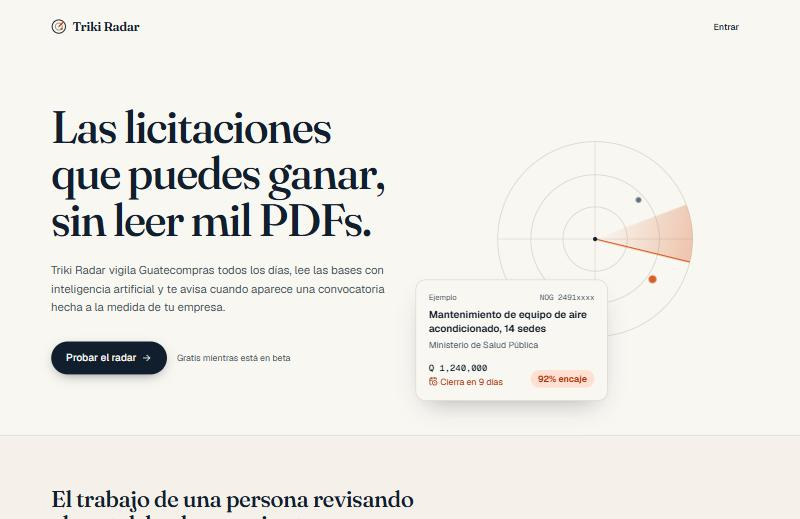
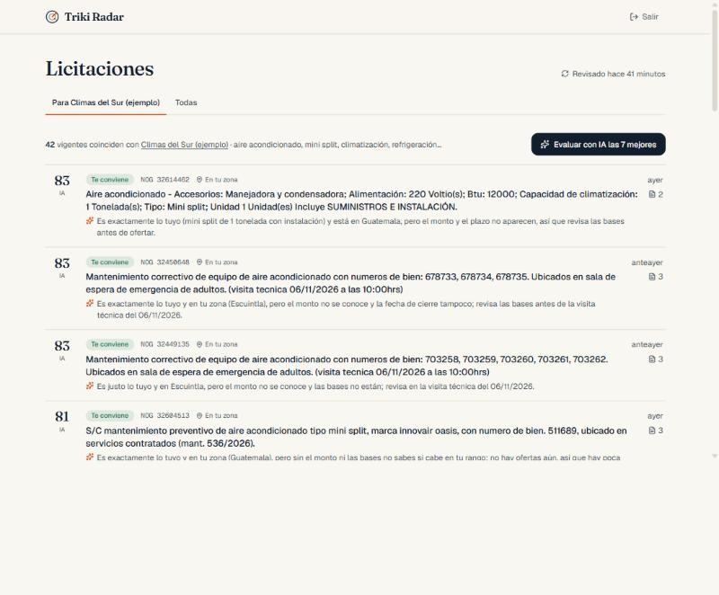
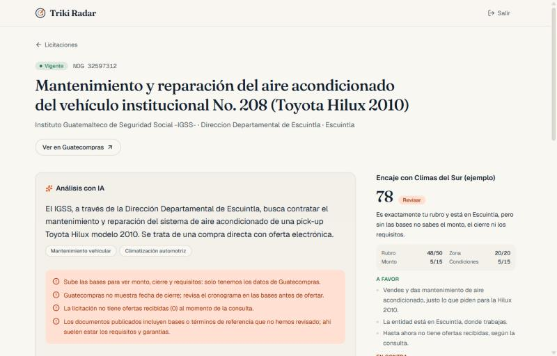
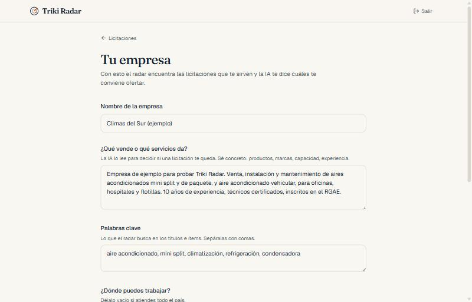
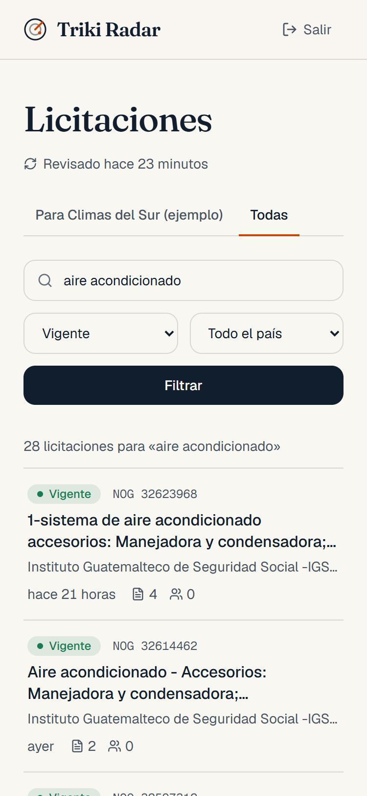
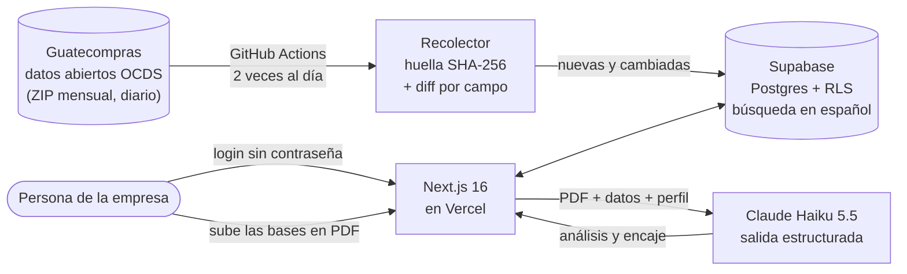

# Triki Radar

**Radar de licitaciones públicas de Guatemala con IA.** Vigila Guatecompras todos los días, detecta cada cambio en las convocatorias, lee las bases con Claude y le dice a cada empresa en cuáles le conviene ofertar y por qué.

🔗 **En vivo:** [radar.trikis.nl](https://radar.trikis.nl) · Hecho por [Gabriel Solís (Trikis)](https://trikis.nl)



---

## El problema

En Guatemala el Estado compra casi todo por **Guatecompras**: medicinas, uniformes, obras, mantenimiento… Cualquier empresa puede venderle al gobierno, pero:

- Se publican **miles de convocatorias al mes** (solo en octubre de 2026 fueron **32,371**).
- Los títulos vienen en MAYÚSCULAS, largos y con códigos.
- Lo que importa para decidir —monto, fecha de cierre, requisitos, garantías— **está dentro de PDFs** de 10 a 50 páginas.
- Un requisito pasado por alto (por ejemplo, faltar a una visita técnica obligatoria) **descalifica la oferta**.

Hoy muchas pymes tienen a una persona revisando el portal a mano todos los días. Triki Radar hace ese trabajo.

## Qué hace

| | |
|---|---|
| 🛰️ **Vigila** | Baja los datos abiertos de Guatecompras dos veces al día (≈ 37 mil procesos del mes actual y el anterior). |
| 🔍 **Detecta cambios** | Compara cada licitación con su versión anterior y explica en español qué cambió: «Pasó de «Vigente» a «Adjudicado». Se adjudicó a X por Q 324,500.00». |
| 🎯 **Filtra para tu empresa** | Con el perfil de la empresa (qué vende, palabras clave, zonas, montos) separa de miles de licitaciones las que le sirven. |
| 🤖 **Lee las bases** | La persona sube el PDF y la IA extrae monto, cierre, visita técnica, requisitos, garantías, documentos y alertas, **cada dato con su página**. |
| ⚖️ **Dice si conviene** | La IA califica el encaje por criterios (rubro, zona, monto, condiciones) y explica a favor, en contra y qué falta saber. |

## Capturas

**Licitaciones para tu empresa**, ordenadas por encaje, con el veredicto de la IA:



**Detalle de una licitación**: análisis con IA, encaje con desglose por criterio, documentos e historial de cambios:



<table>
<tr>
<td width="62%"><strong>Perfil de empresa</strong>: lo que el radar usa para buscar y la IA para evaluar.<br><br></td>
<td width="38%"><strong>En el celular</strong><br><br></td>
</tr>
</table>

## Cómo funciona



1. **Recolección.** Guatecompras publica sus procesos en el estándar internacional [OCDS](https://standard.open-contracting.org/) como un ZIP por mes que se regenera a diario. El recolector lo baja, lo abre en memoria y convierte cada proceso a un formato compacto (de ~6 KB a lo esencial).
2. **Detección de cambios.** Cada licitación tiene una **huella SHA-256** de sus datos. Si la huella cambia, el recolector compara campo por campo (estado, fecha de cierre, documentos, ofertas, adjudicación) y guarda una versión con el resumen del cambio. Una corrida sin cambios procesa 5 mil procesos en ~8 segundos.
3. **Búsqueda y candidatas.** Postgres indexa título, entidad e ítems con búsqueda en español (`tsvector`). Para cada empresa, una función SQL encuentra las vigentes que coinciden con sus palabras clave y les da un **puntaje estimado gratis** (máximo 70).
4. **IA bajo demanda.** Solo cuando alguien lo pide, Claude analiza las bases o evalúa el encaje. El resultado se guarda: si alguien ya subió las bases de una licitación, todos ven el análisis sin pagar de nuevo.

## Decisiones técnicas (y por qué)

- **No se salta la verificación de Guatecompras.** Los PDFs están detrás de una verificación de navegador (Cloudflare). En lugar de burlarla, la persona los baja con un enlace directo que el sistema elige (bases y términos de referencia primero; oculta la versión de la comisión y los formularios) y los sube.
- **Los datos no se usan para entrenar IA.** El `robots.txt` de Guatecompras lo prohíbe (`ai-train=no`). Triki Radar solo los muestra y los analiza para cada usuario. Los datos son CC BY 4.0 y se cita la fuente.
- **La IA no inventa números.** En la primera prueba real, 9 de 10 licitaciones salían con 88 puntos y la IA afirmaba que el monto «cabía en el rango» sin conocerlo. Se rediseñó: la IA da **puntos por criterio con reglas fijas** cuando falta un dato, y el código suma y decide el veredicto. Resultado: puntajes de 67 a 83 en la misma muestra, sin suposiciones.
- **Salida estructurada con esquema (zod).** El análisis siempre tiene los mismos campos; lo que no está en el documento queda vacío. El texto del PDF se trata como contenido, nunca como instrucciones (defensa contra *prompt injection*).
- **Validación de documento.** Si se sube el PDF de otra licitación (pasó en las pruebas), se detecta por el NOG del archivo antes de gastar en la IA, y la IA también lo verifica.
- **Lo que extrae la IA vive en columnas `*_ia`.** El recolector reescribe los datos de Guatecompras en cada corrida y no debe borrar el análisis.
- **Seguridad con RLS.** Las licitaciones son públicas para usuarios con sesión; cada empresa solo ve sus coincidencias y documentos. La clave secreta solo existe en el servidor.
- **Costos acotados.** Haiku 5.5 cuesta ≈ **$0.0006 por análisis sin PDF**, ≈ **$0.004 por PDF de bases** y ≈ **$0.0004 por evaluación de encaje** (medido en `uso_ia`). Límite de 60 usos de IA por persona al día.

## Stack

| Capa | Tecnología |
|---|---|
| Web | **Next.js 16** (App Router, Cache Components, Server Actions, Proxy) · React 19 · TypeScript |
| Estilos | Tailwind CSS 4 · tipografías Fraunces y Geist · íconos Lucide |
| Datos | **Supabase**: Postgres, búsqueda de texto en español, RLS, Auth con enlace mágico |
| IA | **API de Claude** (`claude-haiku-5-5`) con el SDK oficial y salida estructurada con zod |
| Automatización | GitHub Actions (recolector 2 veces al día) |
| Hosting | Vercel + dominio propio |
| Pruebas | `node:test` con tsx: 17 pruebas (detección de cambios, formato de textos, costos, puntaje, elección de documentos) |

## Correr en local

1. Instala dependencias:
   ```bash
   npm install
   ```
2. Crea un proyecto gratis en [supabase.com](https://supabase.com) y ejecuta en **SQL Editor**, en orden, los archivos de [`supabase/migrations/`](supabase/migrations/).
3. En **Authentication → URL Configuration**, pon `http://localhost:3000` como *Site URL* y agrega `http://localhost:3000/auth/callback` a *Redirect URLs*.
4. Copia `.env.example` como `.env.local` y llena la URL, la *publishable key* y la *secret key* de Supabase, y `ANTHROPIC_API_KEY` ([platform.claude.com](https://platform.claude.com)).
5. Trae las licitaciones y arranca:
   ```bash
   npm run recolectar
   npm run dev
   ```

### Comandos

| Comando | Qué hace |
|---|---|
| `npm run dev` | Servidor de desarrollo en http://localhost:3000 |
| `npm run recolectar` | Trae el mes actual y el anterior de Guatecompras y registra los cambios |
| `npm run recolectar -- 2026-09` | Un mes concreto |
| `npm run recolectar -- --seco` | Muestra qué traería, sin escribir en la base |
| `npm run recolectar -- --reprocesar` | Cuando cambia el código del mapeo: actualiza sin crear versiones |
| `npm run enlace-dev -- tu@correo.com` | Solo en local: enlace para entrar sin esperar el correo |
| `npm test` | Pruebas |

## Estructura

| Ruta | Qué hace |
|---|---|
| `src/lib/guatecompras/` | Conversión de OCDS, huella, detección de cambios, recolector y elección de documentos |
| `src/lib/ia/` | Análisis de bases, evaluación de encaje, cálculo del puntaje, costos y límites |
| `src/app/panel/` | Lista con búsqueda y filtros, vista por empresa, detalle y perfil |
| `src/app/api/` | Rutas que llaman a la IA (analizar bases, evaluar encaje) |
| `scripts/` | Recolector y enlace de desarrollo por línea de comandos |
| `supabase/migrations/` | Esquema, búsqueda, funciones y reglas de seguridad |
| `docs/` | [Plan del proyecto](docs/PLAN.md) y [notas sobre los datos de Guatecompras](docs/fuente-guatecompras.md) |

## Lo que sigue

- Alertas por correo o Telegram cuando aparece una licitación con buen encaje.
- Aceptar bases en Word (.docx), muy comunes en Guatecompras.
- Pipeline de seguimiento (revisando → postulando → ganada/perdida).
- Correo propio para el login (el gratuito de Supabase permite pocos envíos por hora).

## Datos

Licitaciones de [Guatecompras](https://ocds.guatecompras.gt/), Ministerio de Finanzas Públicas de Guatemala, publicadas en el estándar OCDS bajo licencia **CC BY 4.0**. Por las reglas del sitio, no se usan para entrenar modelos de IA.
